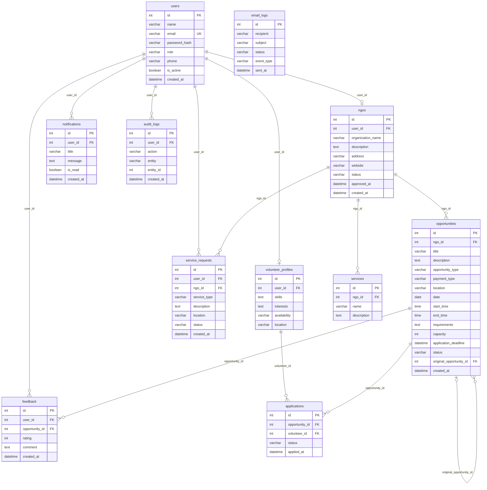

# Volunteer–NGO Platform

A web platform that connects NGOs with volunteers. NGOs register and post volunteering opportunities and services, volunteers build profiles and apply, and administrators approve NGOs and monitor activity.


## Table of Contents
- [Features](#features)
- [System Architecture](#system-architecture)
- [Database Design](#database-design)
- [Tech Stack](#tech-stack)
- [Project Structure](#project-structure)
- [Getting Started](#getting-started)
- [Environment Variables](#environment-variables)
- [User Roles](#user-roles)
- [Contributing](#contributing)
- [License](#license)

## Features

**Admin**
- Approve or reject NGO registrations
- Manage users (activate or deactivate accounts)
- Review audit logs and email logs

**NGO**
- Register an organization profile and wait for approval
- Post, edit and clone volunteering opportunities (paid or unpaid)
- Review and accept or reject volunteer applications
- Publish the services the NGO offers and handle service requests

**Volunteer / User**
- Create a profile with skills, interests, availability and location
- Browse and apply to opportunities
- Request services from NGOs
- Leave ratings and feedback on opportunities
- Receive in-app and email notifications

## System Architecture

The system has three layers:

1. **Presentation layer:** web interfaces for Admin, NGO and Volunteer users.
2. **Application layer:** a backend API with authentication, role-based access control, and modules for NGOs, opportunities, applications, services, feedback, notifications, audit logging and email.
3. **Data layer:** a relational database with 11 tables. Emails are sent through an external SMTP provider.

## Database Design



### Tables

| Table | Purpose |
|-------|---------|
| `users` | Accounts and login details for all roles |
| `ngos` | NGO profiles with an approval status |
| `volunteer_profiles` | Volunteer skills, interests, availability and location |
| `opportunities` | Volunteering opportunities posted by NGOs |
| `applications` | Volunteer applications to opportunities |
| `services` | Services offered by NGOs |
| `service_requests` | Requests for NGO services |
| `feedback` | Ratings and comments on opportunities |
| `notifications` | In-app notifications |
| `audit_logs` | Record of user actions |
| `email_logs` | Record of emails sent by the system |

## Tech Stack

| Layer | Technology |
|-------|-----------|
| Frontend | [e.g. HTML/CSS/JS, React] |
| Backend | [e.g. Flask, Django, Node.js] |
| Database | [e.g. SQLite, MySQL, PostgreSQL] |
| Email | [e.g. SMTP, Flask-Mail] |
| Authentication | Password hashing with role-based access control |

## Project Structure

```
[your-repo]/
├── docs/
│   └── architecture.svg
├── [backend or app folder]/
├── [frontend or templates folder]/
├── requirements.txt        # or package.json
├── .env.example
└── README.md
```

## Getting Started

### Prerequisites
- [Python 3.x / Node.js x.x]
- [Database server, if not using SQLite]

### Installation

```bash
# 1. Clone the repository
git clone [YOUR-REPO-URL]
cd [your-repo]

# 2. Install dependencies
[pip install -r requirements.txt]   # or: npm install

# 3. Configure environment variables
cp .env.example .env

# 4. Initialise the database
[your migration or setup command]

# 5. Run the application
[your run command]
```

The app will be available at `http://localhost:[PORT]`.

## Environment Variables

| Variable | Description |
|----------|-------------|
| `SECRET_KEY` | Secret key for sessions or tokens |
| `DATABASE_URL` | Database connection string |
| `MAIL_SERVER` | SMTP server host |
| `MAIL_PORT` | SMTP port |
| `MAIL_USERNAME` | SMTP username |
| `MAIL_PASSWORD` | SMTP password |

## User Roles

| Role | Access |
|------|--------|
| Admin | Approves NGOs, manages users, views logs |
| NGO | Manages opportunities, services and applications |
| Volunteer | Browses and applies to opportunities, requests services, gives feedback |

Role values are stored in `users.role` ([list your exact values, e.g. `admin`, `ngo`, `vol`]).

## Contributing

1. Fork the repository
2. Create a feature branch: `git checkout -b feature/your-feature`
3. Commit your changes: `git commit -m "Add your feature"`
4. Push the branch: `git push origin feature/your-feature`
5. Open a Pull Request

## License

[Choose a license, e.g. MIT]. See the `LICENSE` file for details.

## Authors

- [K Neha Riona Alice] – [github.com/nehariona]
- [Sreya Vinod Menon] [github.com/sreya-vm]
